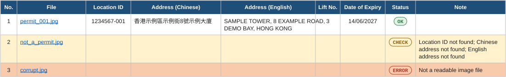

# Permit Reader

Reads photos of Hong Kong EMSD Lift and Escalator Use Permits (准用證) and puts each
permit's **Location ID** and **address** (Chinese and English) into one Excel file,
together with the Lift No. and Date of Expiry. It reads a whole folder of photos in one
run, works offline on the CPU, and is a single Windows exe with nothing to install.

| Runs on | Package | Needs | Speed |
|---|---|---|---|
| CPU only, offline | One 97 MB exe | Windows 10 or 11, 64-bit | About 0.25 s per photo on a 28-thread PC |

**[Download PermitReader.exe](https://github.com/hinagate/permit-reader/releases/latest)**

> All addresses, IDs and dates in this README are made up.

## Use

1. Put `PermitReader.exe` in a folder.
2. Put the permit photos in an `input` folder next to it. Subfolders are included.
3. Double-click `PermitReader.exe`.
4. The results are saved to `output\Permit_Results_<date>_<time>.xlsx`, one file per run.

```
PermitReader.exe
labels.ini <- label settings (created on first run)
input\     <- photos (.jpg .jpeg .png .bmp .tif .tiff .webp)
output\    <- Excel results
```

You can also drag a folder onto the exe, or run it from a command prompt:

```
PermitReader.exe "D:\Photos\Batch 3" -o "D:\Results"
PermitReader.exe --labels "D:\Settings\escalators.ini"
PermitReader.exe --workers 2      (use fewer CPU cores / less memory)
```

The exe is not code-signed, so Windows SmartScreen may warn the first time you run it.
Click **More info**, then **Run anyway**.

## The Excel file



**Permits sheet:** one row per photo. Click a file name to open the photo.

| Status | Meaning |
|---|---|
| OK | Location ID and both addresses were read clearly |
| CHECK (yellow) | Something is missing or unclear. The Note column says what. Check against the photo |
| ERROR (red) | The file could not be opened as an image |

OK needs a Location ID in the form 7 digits, dash, 3 digits, and both addresses, read with
a confidence of at least 0.85 for the ID and 0.75 for the address.

**OCR Text sheet:** all the text read from each photo, for checking CHECK rows.

## Labels and extra fields (labels.ini)

Each field is found by the label printed beside it on the permit, such as
地址 / Address. Open `labels.ini` in Notepad to change the label words or to
add your own fields. Each extra field becomes an extra Excel column.

```ini
[Address]
labels = 地址 | Address          ; label words, separated by |

[Date of Issue]                  ; your own field: the name is the column title
labels = 發出日期 | Date of Issue
type = date                      ; text (default) or date
```

- `type = text` reads the text to the right of the label, on the same line.
- `type = date` reads a Day / Month / Year date laid out like the expiry date.
- Labels are matched at the start of a line. Spaces and upper/lower case do not
  matter, and one OCR spelling mistake in a long English word is allowed.
- Traditional and Simplified forms of common Chinese characters both match.
- The **OCR Text** sheet shows how each label was actually read.
- Delete `labels.ini` to get the default settings back.

## How it works

### 1. From folder to Excel

The main process lists every photo in `input\` and hands them out to a pool of OCR
workers. Each worker loads the OCR models once and then reads one photo at a time.
Results come back in any order, are put back in file order, and go into one Excel file.


Each worker is a separate process of about 300 MB. Workers = CPUs ÷ 2 (at most 8), and
threads per worker = CPUs ÷ workers (at most 4). On a 28-thread PC that means 8 workers ×
3 threads; a typical 8-thread office PC gets 4 × 2. One unreadable photo becomes an ERROR
row, and the batch carries on.

### 2. What happens to each photo

Most photos take the blue path: one fast OCR pass, then straight to a status. The two
loops only run when the first pass looks wrong, so they cost time only on difficult photos.


- **Upright?** means at least two printed labels were found and the text lines run across
  the photo. If lines run up and down but still read correctly, the photo was turned
  clockwise, so 270° is tried first. Upside-down text reads as nonsense, so 180° is tried first.
- **All fields?** means a Location ID in 7-3 form plus both addresses.

### 3. Finding the fields

OCR returns loose lines of text with their positions. The parser uses the permit's printed
labels as anchors and reads a region beside each one. The figure is a permit drawn to scale
from real OCR boxes, with the values replaced by dummy data.


| | Field | Where it is read |
|---|---|---|
| **A** | Location ID | Same row as 地點編號 / Location ID, stopping at Lift No. Must read as 7 digits, dash, 3 digits. Letter look-alikes such as O and l are fixed, and a missing dash is put back. |
| **B** | Lift No. | Right of 升降機編號 / Lift No. Escalator permits (自動梯編號) are matched too. |
| **C** | Address | Below the Location ID row, right of 地址 / Address, above the expiry label. Lines with Chinese characters form the Chinese address; the rest form the English one. |
| **D** | Date of Expiry | Numbers on the 屆滿日期 line, each paired with the Day / Month / Year caption directly below it (dotted guides). If they don't line up, the date is left blank rather than guessed. |
| **×** | Date of Issue | Same layout one row lower, so it is skipped. It can be added as an extra field in `labels.ini`. |

The OCR often returns Simplified characters (here 地点编号 and 届满日期), so labels match
in either form. The boxes are first rotated to undo camera tilt, so rows still line up.

## Technology

| Layer | Technology | Job in Permit Reader |
|---|---|---|
| Packaging | PyInstaller 6.22, one-file mode | Bundles Python, every library, the OCR models and the Visual C++ runtime DLLs into `PermitReader.exe`. It unpacks to `%TEMP%` at start, so the PC needs nothing installed. |
| Language | Python 3.14 | `permit_reader.py`, about 850 lines: loading, retries, label matching, layout parsing, the worker pool and the Excel writer. |
| OCR pipeline | RapidOCR 3.10 | Finds text lines, crops them and reads them. Its models ship inside the package, so nothing downloads at runtime. |
| Models | PP-OCRv6 small (PaddleOCR, ONNX format) | Detection (9.5 MB) finds where the text is. Recognition (20.3 MB) reads Traditional Chinese, Simplified Chinese and English with one model. The bundled angle classifier is switched off; whole-photo rotation replaces it. |
| Inference | ONNX Runtime 1.31 (CPU) | Runs the models. Thread spin-waiting is turned off so parallel workers don't compete for the same cores. |
| Images | Pillow 13, OpenCV 5, NumPy 2.5 | Pillow decodes photos, applies the phone's EXIF rotation and decodes large JPEGs at reduced size. OpenCV does crops and resizes inside RapidOCR. |
| Geometry | Shapely, pyclipper | Used by RapidOCR to turn the detection map into text boxes. |
| Excel | openpyxl 3.1 | Writes the .xlsx: real date cells, links to each photo, colored status rows, frozen header, filters and the OCR Text sheet. |

Considered and not used:

- **Tesseract OCR:** a separate program to bundle, and weaker on Traditional Chinese.
- **EasyOCR:** needs PyTorch, which makes the exe far larger and slower on CPU.
- **Windows built-in OCR:** needs the Chinese language pack installed on every PC.
- **The permit's QR code:** too small and blurry in a phone photo to decode.

## Inside the 97 MB exe


Compressed sizes inside the exe (MB = 1,048,576 bytes). At start it unpacks to about
214 MB in `%TEMP%`, which takes about 2 seconds. OpenCV's video module (31 MB of FFmpeg)
and Pillow's AVIF plugin are left out because nothing uses them.

## Speed tuning

One photo on the build PC, with each change added on top of the one before:


Turning off ONNX Runtime's thread spin-waiting made batches much faster:

| Batch test | Workers × threads | Spin-wait on | Spin-wait off |
|---|---|---:|---:|
| Build PC, 28 threads, 112 photos | 7 × 4 | 34.5 s | 25.8 s |
| Simulated 8-thread PC, per photo | 2 × 4 → 4 × 2 | 0.82 s | 0.47 s |
| Simulated 4-thread PC, per photo | 2 × 4 → 2 × 2 | 2.42 s | 0.87 s |

The smaller PCs were simulated by limiting the program to 4 or 8 logical CPUs on the build
machine. The 2.42 s row shows what happens when workers × threads exceeds the CPU count,
which the automatic setting now avoids. Timings varied between runs on the build PC's
hybrid-core CPU, so read them as direction, not exact figures. On a typical 4-core office
PC, expect about 1–2 photos per second. The first run after starting takes a few extra
seconds while the exe unpacks itself.

## Tips for good results

- Photograph the permit straight on, filling most of the frame, without glare.
- Sideways or upside-down photos are handled automatically.
- iPhone HEIC photos are not supported. Send them as JPEG, or set
  Camera > Formats > Most Compatible.

## Limitations

- So far the parser has been checked against one real permit photo and altered copies of
  it (rotated, skewed, shrunk, low JPEG quality, perspective). Permits with a different
  layout may need label changes in `labels.ini`. If something is misread, the OCR Text
  sheet shows what the OCR saw.
- Windows 10 or 11, 64-bit only.

## Building the exe

Requires Python 3.14 (64-bit). Run `build.bat`. It creates `.venv`, installs
`requirements.txt` and builds `PermitReader.exe` with PyInstaller using
`PermitReader.spec`. The source is `permit_reader.py`.

To run from source instead:

```
pip install -r requirements.txt
python permit_reader.py
```
